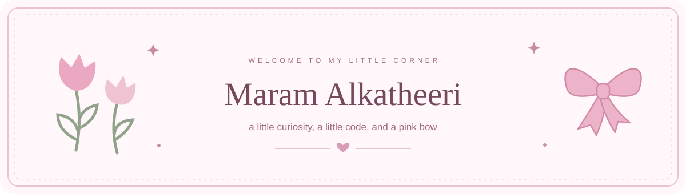

  

<h3 align="center">🌷 hi, i'm Maram 🎀</h3>

  welcome to my little corner of GitHub ♡ 
  learning, exploring, and letting ideas bloom — one line of code at a time.

🌷 ˚₊‧꒰ა ♡ ໒꒱ ‧₊˚ 🎀

### 🎀 my toolkit

  
  
  
  
  
  

### 🌷 let's connect

growing at my own pace, with a bow on top 🎀

